

<picture>
  <source media="(prefers-color-scheme: dark)" srcset=".github/assets/hero-dark.svg">
  <source media="(prefers-color-scheme: light)" srcset=".github/assets/hero-light.svg">
  
</picture>

<picture>
  <source media="(prefers-color-scheme: dark)" srcset=".github/assets/tagline-dark.svg">
  <source media="(prefers-color-scheme: light)" srcset=".github/assets/tagline-light.svg">
  
</picture>

 

 

 

**[العربية](#ar)** &nbsp;·&nbsp; **[English](#en)** &nbsp;·&nbsp; [الشاشات · Screens](#screens) &nbsp;·&nbsp; [المزايا · Features](#features) &nbsp;·&nbsp; [خارطة الطريق · Roadmap](#roadmap) &nbsp;·&nbsp; [المصادر · Sources](#sources)

 

<picture>
  <source media="(prefers-color-scheme: dark)" srcset=".github/assets/showcase-dark.webp">
  <source media="(prefers-color-scheme: light)" srcset=".github/assets/showcase-light.webp">
  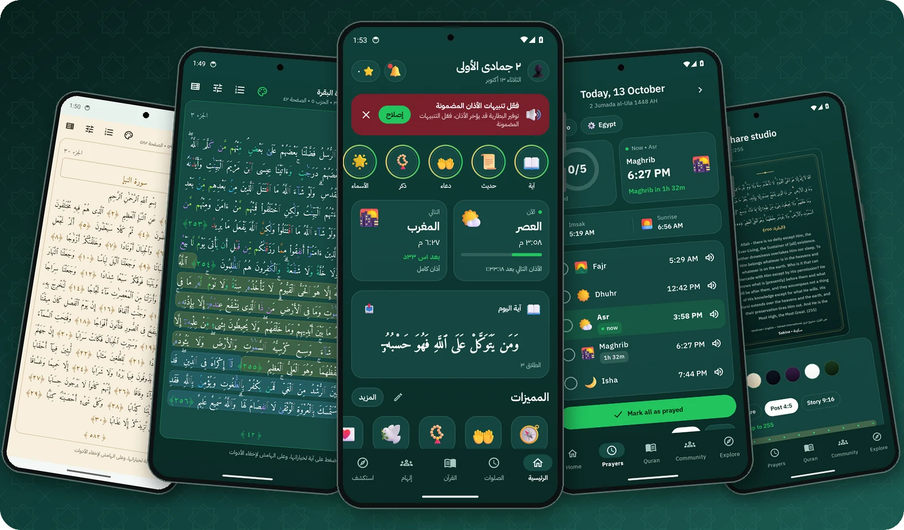
</picture>

<picture>
  <source media="(prefers-color-scheme: dark)" srcset=".github/assets/stats-dark.svg">
  <source media="(prefers-color-scheme: light)" srcset=".github/assets/stats-light.svg">
  
</picture>

  <picture>
    <source media="(prefers-color-scheme: dark)" srcset=".github/assets/divider-dark.svg">
    <source media="(prefers-color-scheme: light)" srcset=".github/assets/divider-light.svg">
    
  </picture>

## 🌙 ما هو «سكينة»؟

**سكينة** تطبيق أندرويد للقرآن الكريم ومواقيت الصلاة والأذكار، مكتوب بالكامل بـ Kotlin و Jetpack Compose،
عربي أولًا مع واجهة إنجليزية كاملة. مجاني تمامًا: **بلا إعلانات، بلا اشتراكات، بلا حسابات، بلا تتبّع**.
نص المصحف والمواقيت والأذكار تعمل دون إنترنت، وموقعك لا يغادر جهازك.

> [!NOTE]
> التطبيق قيد التطوير النشط (الإصدار `0.1.0`). كل ما في هذه الصفحة من صور هو لقطات حقيقية من محاكي أندرويد
> تُلتقط آليًا في GitHub Actions مع كل بناء، وليست تصاميم تخيلية.

## 🌙 What is Sakina?

**Sakina** (سكينة, *tranquillity*) is a native Android app for the Holy Quran, prayer times and daily remembrance,
written in Kotlin and Jetpack Compose. It is Arabic-first with a complete English interface, and it is free in the
plainest sense: **no ads, no subscriptions, no accounts, no analytics**. The Quran text, prayer times and azkar work
fully offline, and your location never leaves your phone.

> [!NOTE]
> Sakina is in active development (version `0.1.0`). Every image on this page is a real screenshot captured
> automatically on an Android emulator by GitHub Actions — no concept art.

<picture>
  <source media="(prefers-color-scheme: dark)" srcset=".github/assets/h-showcase-dark.svg">
  <source media="(prefers-color-scheme: light)" srcset=".github/assets/h-showcase-light.svg">
  
</picture>

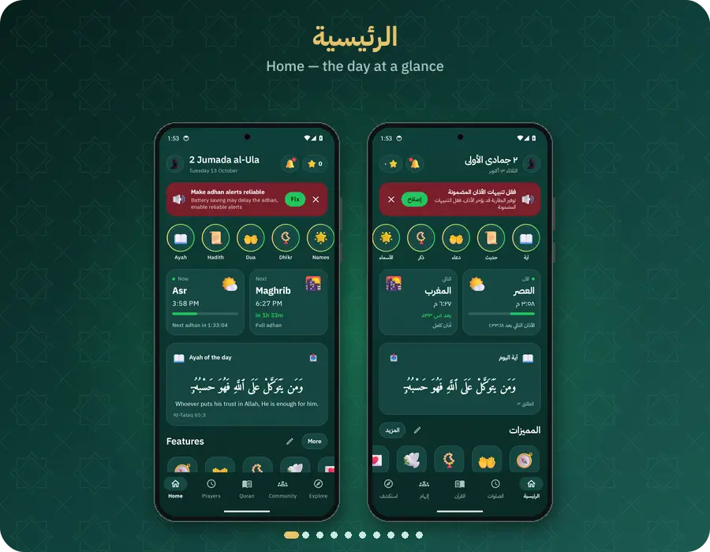

كل شريحة تعرض الشاشة نفسها بالعربية والإنجليزية · each slide shows the same screen in Arabic and English

  

<table>
<tr>
<td align="center">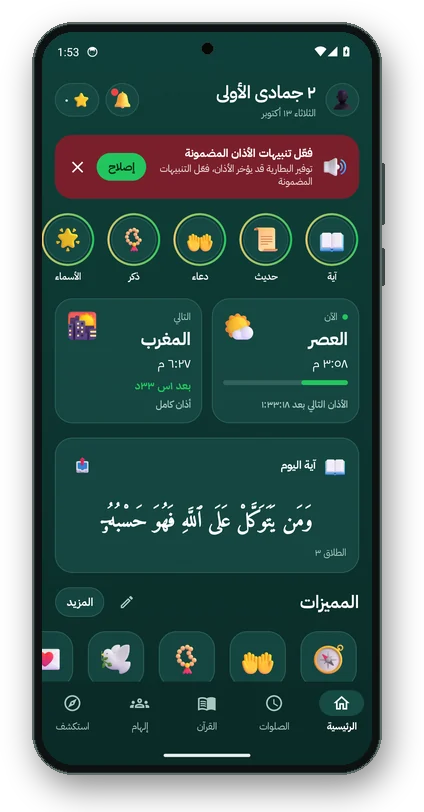 <b>الرئيسية</b> Home · AR dark</td>
<td align="center">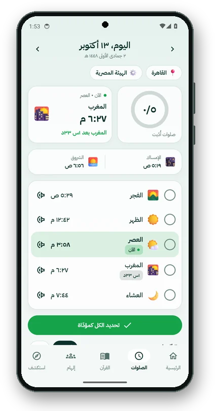 <b>مواقيت الصلاة</b> Prayer times · AR light</td>
<td align="center">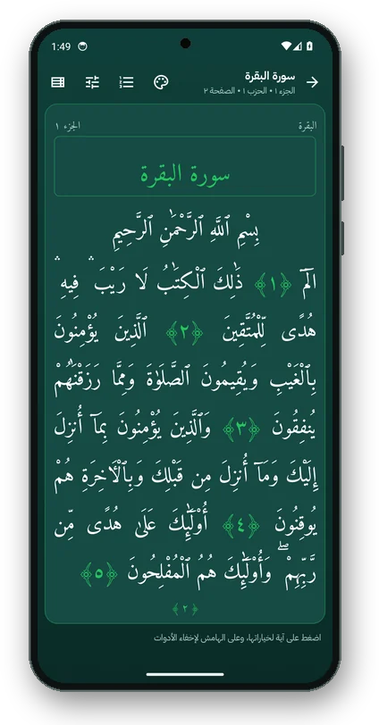 <b>المصحف</b> 604-page mushaf</td>
<td align="center">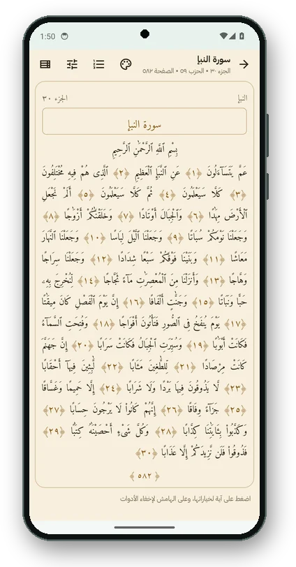 <b>ورق عاجي</b> Sepia reading tone</td>
</tr>
<tr>
<td align="center">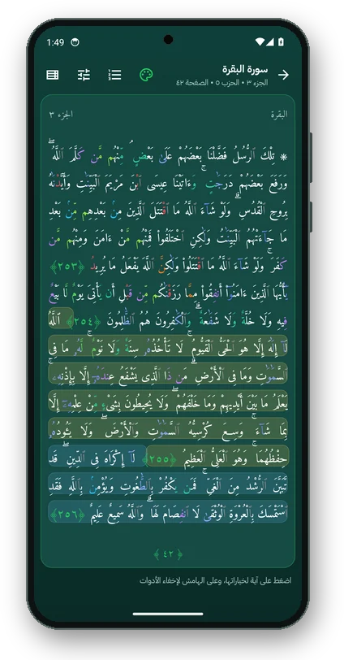 <b>التجويد الملوّن</b> Tajweed &amp; highlights</td>
<td align="center">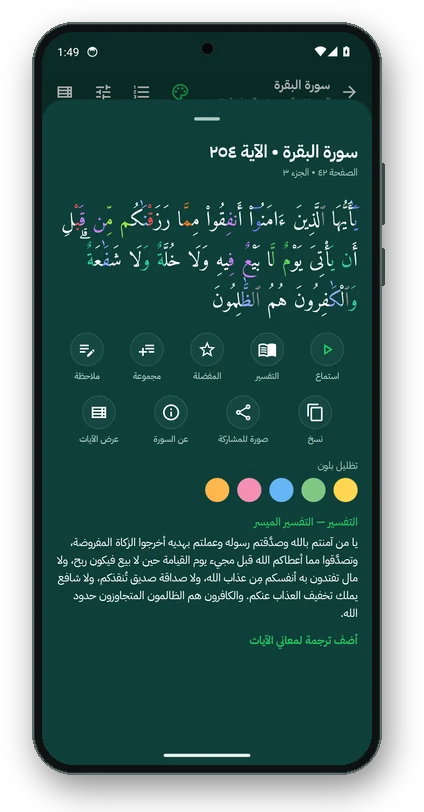 <b>لوحة الآية</b> Ayah sheet + tafsir</td>
<td align="center">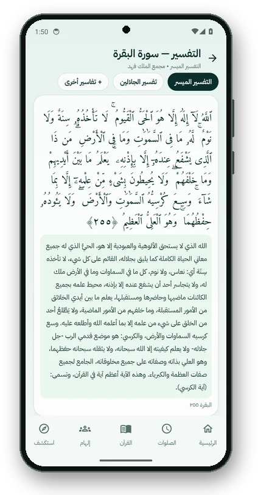 <b>التفسير</b> Tafsir · AR light</td>
<td align="center">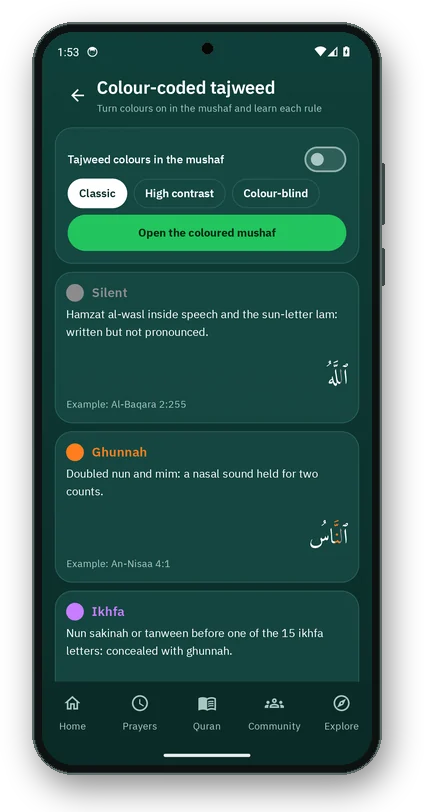 <b>دليل التجويد</b> Tajweed guide · EN</td>
</tr>
<tr>
<td align="center">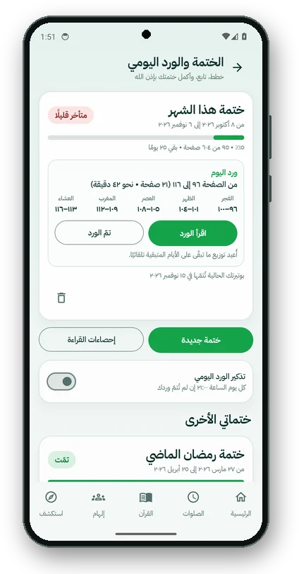 <b>الختمة</b> Khatma &amp; daily wird</td>
<td align="center">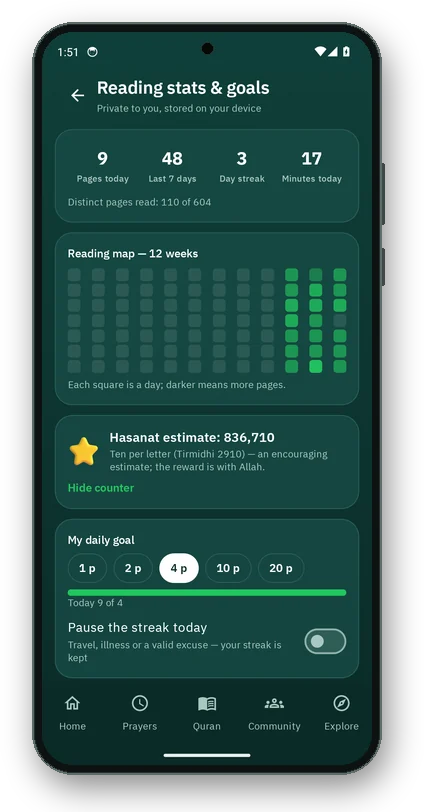 <b>إحصاءات القراءة</b> Reading stats · EN</td>
<td align="center">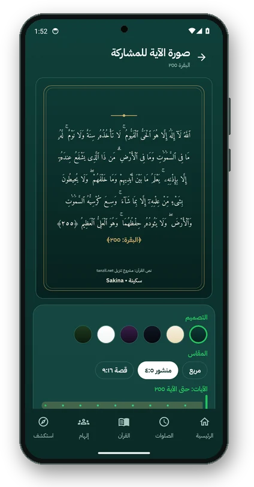 <b>استوديو المشاركة</b> Ayah share studio</td>
<td align="center">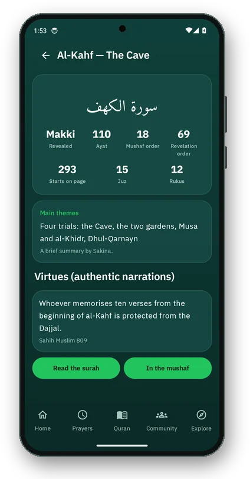 <b>بطاقة السورة</b> Surah info · EN</td>
</tr>
<tr>
<td align="center">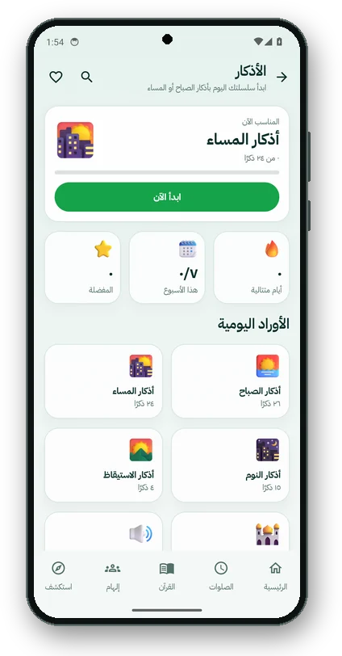 <b>الأذكار</b> Azkar · AR light</td>
<td align="center">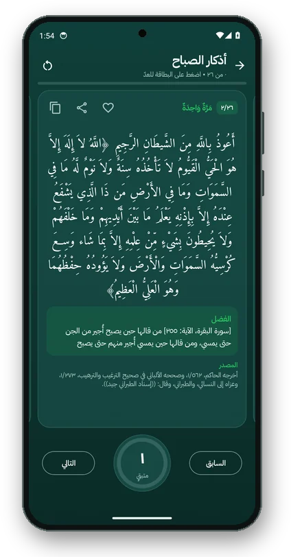 <b>جلسة الأذكار</b> Azkar session</td>
<td align="center">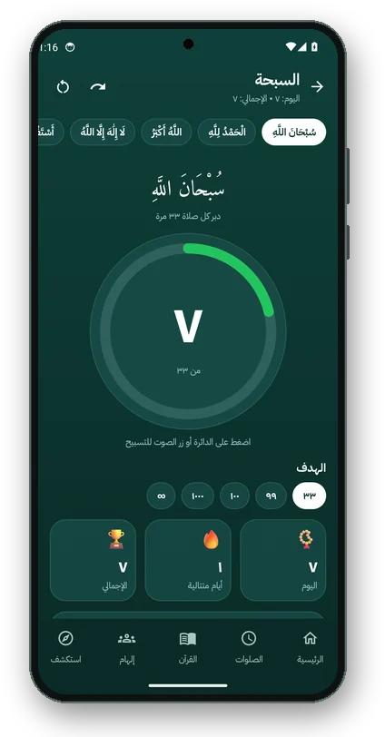 <b>السبحة</b> Tasbih</td>
<td align="center">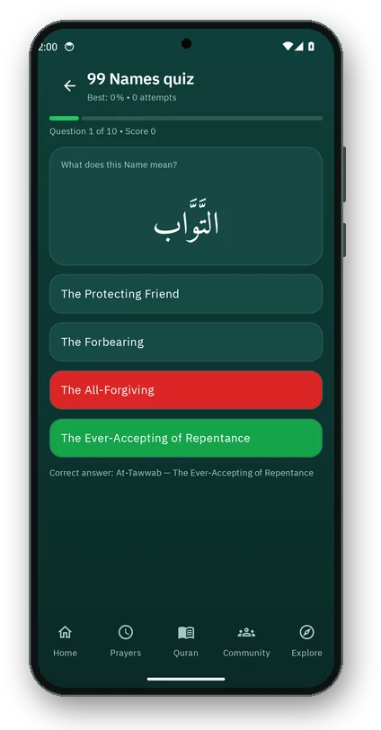 <b>اختبار الأسماء</b> 99 Names quiz · EN</td>
</tr>
<tr>
<td align="center">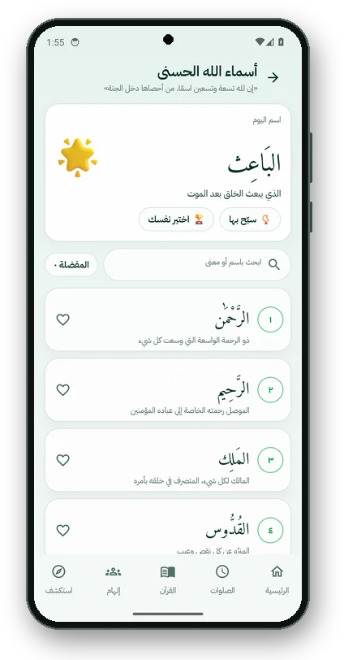 <b>الأسماء الحسنى</b> 99 Names · AR light</td>
<td align="center">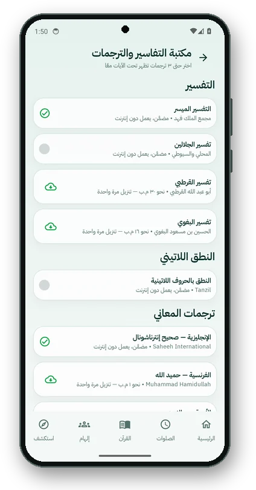 <b>المكتبة</b> Tafsir &amp; translations</td>
<td align="center">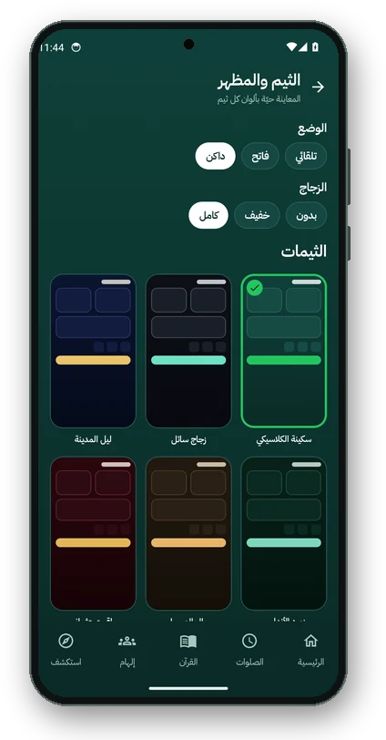 <b>الثيمات</b> 11 themes</td>
<td align="center">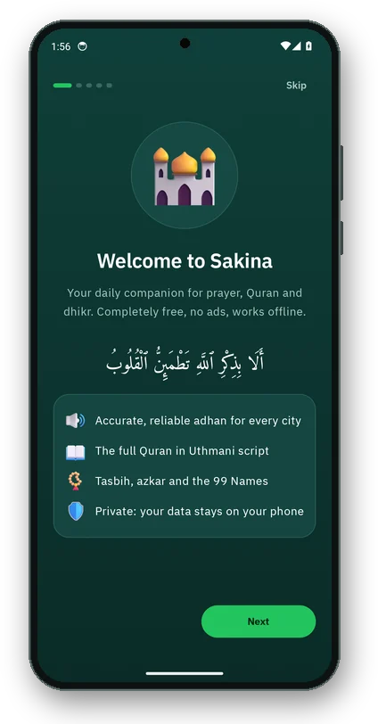 <b>البداية</b> Onboarding · EN</td>
</tr>
</table>

<b>المزيد من الشاشات · More screens</b>

 
<table>
<tr>
<td align="center">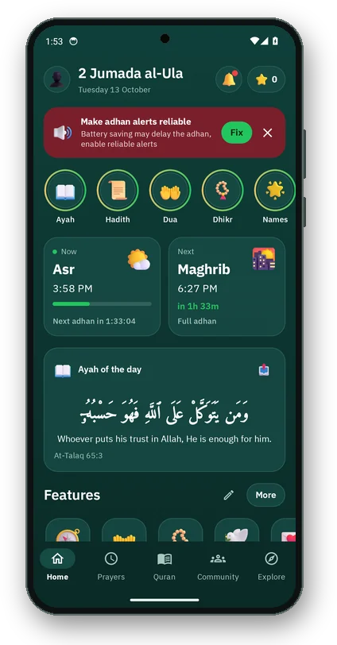 Home · EN</td>
<td align="center">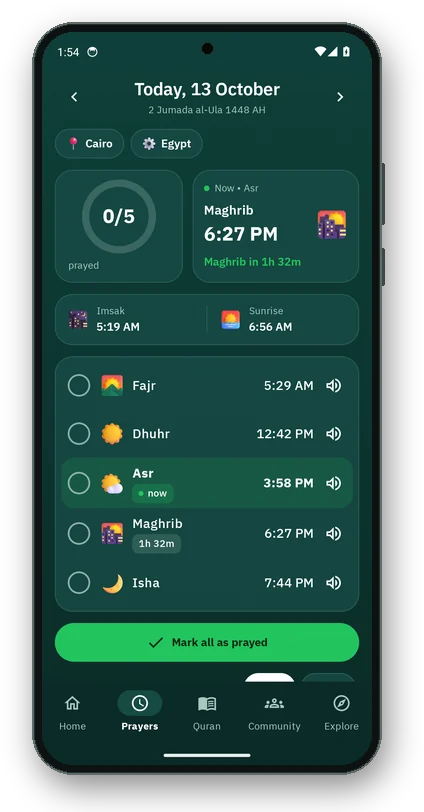 Prayers · EN</td>
<td align="center">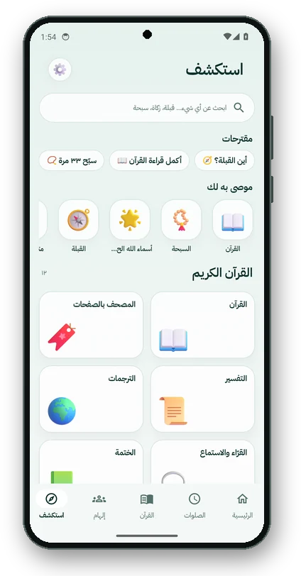 Explore · AR light</td>
<td align="center">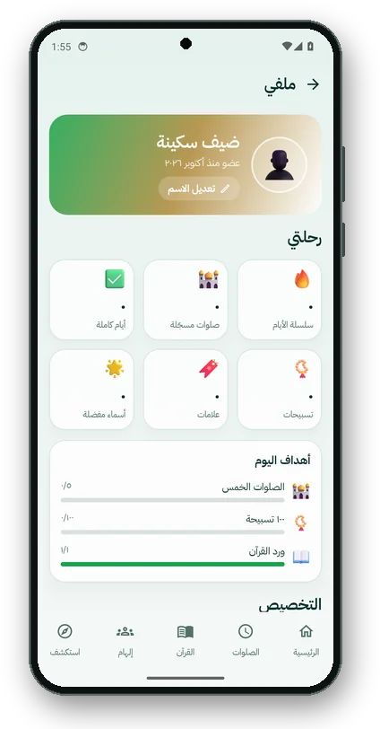 Profile · AR light</td>
</tr>
</table>

  <picture>
    <source media="(prefers-color-scheme: dark)" srcset=".github/assets/divider-dark.svg">
    <source media="(prefers-color-scheme: light)" srcset=".github/assets/divider-light.svg">
    
  </picture>

<picture>
  <source media="(prefers-color-scheme: dark)" srcset=".github/assets/h-features-dark.svg">
  <source media="(prefers-color-scheme: light)" srcset=".github/assets/h-features-light.svg">
  
</picture>

هذه القائمة تذكر ما هو موجود فعلًا في الشيفرة اليوم فقط · only what exists in the code today — planned work is under <a href="#roadmap">Roadmap</a>

<b>🕌 الصلاة والقبلة</b>

- مواقيت دقيقة على الجهاز بكل طرق الحساب، واختيار تلقائي حسب البلد (مصر ← الهيئة المصرية العامة للمساحة)
- مذهب العصر (شافعي/حنفي) وقواعد خطوط العرض العليا، ومدن دون إنترنت أو GPS أو إحداثيات يدوية
- تنبيه الأذان بصوت الأذان الكامل أو التكبير، ونمط تنبيه لكل صلاة، وزر إيقاف
- فحص «لماذا لم يؤذّن؟»: الإشعارات، المنبّه الدقيق، توفير البطارية، مع إصلاح بلمسة
- متتبّع الصلوات مع تقدّم أسبوعي/شهري وسلاسل، وأوقات الليل والأوقات المكروهة
- بوصلة القبلة والمسافة إلى الكعبة، والتاريخ الهجري (أم القرى) مع ضبط الفرق، وودجت المواقيت

<b>📖 القرآن الكريم</b>

- نص المصحف العثماني من مشروع تنزيل **دون أي تعديل** (٦٬٢٣٦ آية)، يعمل دون إنترنت
- مصحف بتخطيط ٦٠٤ صفحات يُرسم نصًّا (لا صور)، وقارئ آيات، وفهرس السور والأجزاء
- بحث لا يتأثر بالتشكيل والهمزات، ونسخ الآية مع مرجعها
- المفضلة والمجموعات، والتظليل الموضوعي بالألوان، والملاحظات والوسوم على الآيات
- الرسم العثماني والإملائي، وثيمات القراءة ومنها الورق العاجي، والتمرير التلقائي
- بطاقة السورة (مكية/مدنية، عدد الآيات، الموضوعات، الفضائل الصحيحة) وفهرس موضوعات من إعداد سكينة

<b>🎨 التجويد</b>

- مصحف ملوّن بأحكام التجويد يحسبه محرّك قواعد خاص بسكينة على الجهاز فوق نص تنزيل غير المعدَّل
- دليل لكل حكم مع أمثلة، ولوحة ألوان عالية التباين وأخرى لعمى الألوان

<b>📚 التفسير والترجمات</b>

- مضمّن: التفسير الميسر، تفسير الجلالين، Saheeh International، والنقحرة اللاتينية
- تنزيل عند الطلب: ١٥ ترجمة أخرى من تنزيل، وتفسيرا القرطبي والبغوي
- عرض الترجمات جنبًا إلى جنب، وشاشة تفسير كاملة، وبحث في الترجمات والتفاسير

<b>🗓️ الختمة والورد</b>

- ختمات متعددة بأسماء، وخطة حسب تاريخ الانتهاء مع تقسيم الورد على الصلوات الخمس
- إعادة توزيع المتبقي تلقائيًا عند التأخر، وتذكير يومي بالورد
- خريطة قراءة حرارية، وتقدير الحسنات، وأهداف يومية وتحديات (الكهف كل جمعة، الملك كل ليلة…)

<b>🖼️ استوديو مشاركة الآيات</b>

- صورة للآية بمقاسات مربع و٤:٥ وقصة، بتصاميم متعددة، مع الترجمة أو التفسير ونَسب المصدر تلقائيًا

<b>🤲 الأذكار والأدعية</b>

- حصن المسلم كاملًا: ١٣٣ بابًا و٣٠٢ ذكرًا بمراجعها
- أذكار الصباح والمساء مع الفضل، وأذكار بعد الصلاة والنوم والاستيقاظ، وأدعية المناسبات
- ٤٣ دعاءً قرآنيًا، والأدعية النبوية، والرقية الشرعية، ودليل الاستخارة
- عدّاد لكل ذكر مع اهتزاز وانتقال تلقائي، وأذكارك الخاصة والمفضلة، والبحث، وتذكيرات الصباح والمساء والنوم، ومشاركة الذكر صورةً

<b>📿 السبحة والأسماء الحسنى</b>

- سبحة بأهداف ٣٣/٩٩/١٠٠/١٠٠٠/∞، وتسبيح فاطمة، والعدّ بأزرار الصوت، وأشكال ونقرات، وسجل ورسم أسبوعي
- أسماء الله الحسنى التسعة والتسعون بالتشكيل والنقحرة والمعاني، واسم اليوم، والمفضلة، واختبار الأسماء

<b>✨ التخصيص والخصوصية</b>

- ١١ ثيمًا، فاتح/داكن/AMOLED، وتأثير زجاجي، وحِزم أيقونات، وأرقام عربية هندية
- عربي أولًا مع اتجاه RTL كامل وواجهة إنجليزية كاملة، وتعريف أوّلي يشرح كل إذن بوضوح
- الملف الشخصي وإحصاءات رحلتك، وكتالوج «استكشف» مع البحث
- لا إعلانات، لا حسابات، لا تحليلات، والموقع يبقى على الجهاز

<b>🇬🇧 The same list in English</b>

**🕌 Prayer & qibla** — on-device times with every calculation method and auto-pick by country · Asr madhab and
high-latitude rules · offline cities, GPS or manual coordinates · full adhan or takbeer alerts with a per-prayer
mode and a stop action · a "why didn't the adhan ring?" health check (notifications, exact alarms, battery) with
one-tap fixes · prayer tracker with week/month progress and streaks · night and disliked times · qibla compass and
distance to the Kaaba · Umm al-Qura Hijri date with offset · prayer-times widget.

**📖 Quran** — Tanzil Uthmani text, **unaltered** (6,236 ayat), fully offline · 604-page mushaf layout rendered as
text, not images · ayah reader, surah and juz index · diacritic- and hamza-insensitive search · copy with reference ·
favourites and collections, colour highlights, notes and tags · Uthmani and Imlaei scripts · reading tones incl.
sepia · auto-scroll · surah info cards and a topic index written for Sakina.

**🎨 Tajweed** — colour-coded mushaf computed on-device by Sakina's own rule engine over the unaltered text · a guide
for every rule · high-contrast and colour-blind palettes.

**📚 Tafsir & translations** — bundled: al-Muyassar, al-Jalalayn, Saheeh International, transliteration · on demand:
15 more Tanzil translations, al-Qurtubi and al-Baghawi · side-by-side view, full-screen tafsir, search.

**🗓️ Khatma** — several named khatmas · plan by end date, split across the five prayers · automatic rebalancing ·
daily wird reminder · reading heatmap, hasanat estimate, goals and challenges.

**🖼️ Share studio** — ayah images in square, 4:5 and story sizes with several designs, translation or tafsir, and the
source credited automatically.

**🤲 Azkar** — complete Hisn al-Muslim (133 chapters, 302 adhkar, with references) · morning and evening adhkar with
virtues · after-prayer, sleep and waking adhkar · 43 Quranic duas, prophetic duas, ruqyah, istikhara guide · counters
with haptics and auto-advance · your own azkar and favourites · search · reminders · share as image.

**📿 Tasbih & 99 Names** — targets 33/99/100/1000/∞, Tasbih Fatimah, volume-key counting, skins and click sound,
history and a 7-day chart · the 99 Names with tashkeel, transliteration and meanings, name of the day, favourites and
a quiz.

**✨ Personal & private** — 11 themes, light/dark/AMOLED, glass effect, icon packs, Arabic-Indic digits · full RTL
Arabic plus English · onboarding that explains every permission · profile and journey stats · searchable Explore
catalogue · no ads, no accounts, no analytics, location stays on the device.

  <picture>
    <source media="(prefers-color-scheme: dark)" srcset=".github/assets/divider-dark.svg">
    <source media="(prefers-color-scheme: light)" srcset=".github/assets/divider-light.svg">
    
  </picture>

<picture>
  <source media="(prefers-color-scheme: dark)" srcset=".github/assets/h-roadmap-dark.svg">
  <source media="(prefers-color-scheme: light)" srcset=".github/assets/h-roadmap-light.svg">
  
</picture>

| | Wave | الموجة | What it brings |
|:-:|---|---|---|
| ✅ | **D1** Foundation | الأساس | Home, prayers, themes, tracker, adhan health check |
| ✅ | **Q1** Mushaf core | المصحف | Tanzil text, 604-page layout, index, search |
| ✅ | **A1** Azkar | الأذكار | Hisn al-Muslim, duas, ruqyah, tasbih, 99 Names |
| ✅ | **Q2** Understanding | الفهم | Tafsir, translations, tajweed, khatma, share studio *(word-by-word, morphology, asbab al-nuzul, roots and gharib still to come)* |
| ⏳ | **AU1** Recitation audio | التلاوة | 243 reciters from mp3quran.net, ayah highlighting, background playback, downloads on your device |
| ⏳ | **P2** Prayer depth | عمق الصلاة | More adhan voices (CC0 / public-domain), per-prayer sounds, qada tracker, Qibla on a map |
| ⏳ | **SN** Smart notifications | تنبيهات ذكية | Adaptive reminders, Friday and fasting-day context, khatma pace coach, quiet hours |
| ⏳ | **Q3** Hifz & tajweed practice | الحفظ | Hide/reveal, repeat ladders, spaced review, record-and-compare |
| ⏳ | **F1** Calendar & Ramadan | التقويم ورمضان | Hijri events, imsakiya, fasting tracker, last-ten-nights planner |
| ⏳ | **H1** Hadith & knowledge | الحديث والعلم | Hadith collections, seerah, fiqh notes, unified search |
| ⏳ | **K1** Family | الأسرة | Kids corner, women's tools, new-Muslim path |
| ⏳ | **L1** Learning | التعلّم | Tajweed course, Qaida, quizzes, Quranic Arabic |
| ⏳ | **Z1** Zakat & inheritance | الزكاة والمواريث | Zakat calculator and a faraid engine (educational, not a fatwa) |
| ⏳ | **T1** Pilgrimage & tools | الحج والعمرة | Offline Hajj & Umrah guide, halal places |
| ⏳ | **C1 · C2** Sync & community | المزامنة والمجتمع | Optional sign-in and sync; moderated community features |
| ⏳ | **AI1** Ask with sources | اسأل بمصادر | Answers that cite Quran and hadith, clearly marked "not a fatwa" |
| ⏳ | **V1 · AU2** Video, radio & audio extras | مرئيات وصوتيات | Curated video, live radio, playlists, listening khatma |
| ⏳ | **WA** Admin console | لوحة الإدارة | Owner console for remote config and content review |
| ⏳ | **WO1** Widgets & Wear OS | الودجت والساعة | More widgets, Wear OS, Android Auto, cast |
| ⏳ | **R1** Polish & release | الإطلاق | Accessibility pass, more languages, credits screen, Play release |

  <picture>
    <source media="(prefers-color-scheme: dark)" srcset=".github/assets/divider-dark.svg">
    <source media="(prefers-color-scheme: light)" srcset=".github/assets/divider-light.svg">
    
  </picture>

<picture>
  <source media="(prefers-color-scheme: dark)" srcset=".github/assets/h-tech-dark.svg">
  <source media="(prefers-color-scheme: light)" srcset=".github/assets/h-tech-light.svg">
  
</picture>

| Layer | Choice |
|---|---|
| Language & UI | Kotlin 2.3 · Jetpack Compose (BOM 2026.06) · Material 3 · Navigation Compose |
| Build | AGP 8.13 · Gradle 8.14 · minSdk 24 · target/compile SDK 36 · R8 |
| State | DataStore (settings, personal data, Quran notes) — all on the device |
| Prayer engine | [adhan-java](https://github.com/batoulapps/adhan-java) 1.2.1 (MIT) · `java.time` Hijri (Umm al-Qura) |
| System | Exact alarms + foreground adhan service · boot/time-zone receivers · App Widget |
| Visuals | [Haze](https://github.com/chrisbanes/haze) glass blur · Amiri Quran & IBM Plex Sans Arabic fonts |
| CI | GitHub Actions: build + 37 unit tests → three emulators in parallel (Arabic dark, English dark, Arabic light) → screenshots |

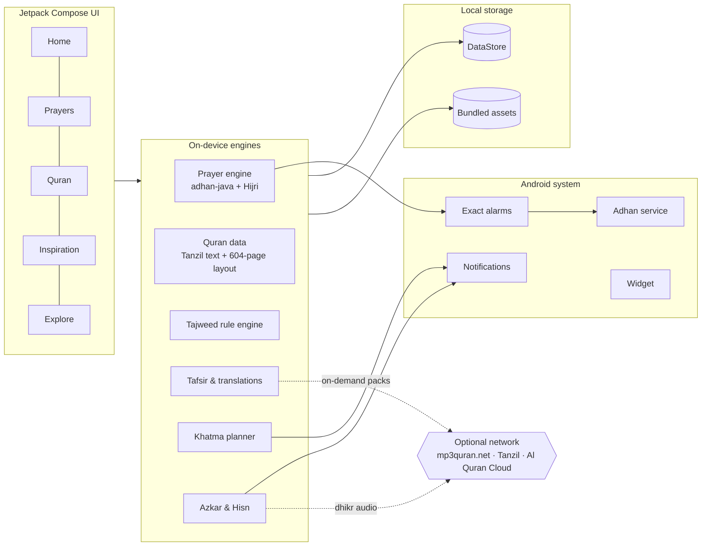

  <picture>
    <source media="(prefers-color-scheme: dark)" srcset=".github/assets/divider-dark.svg">
    <source media="(prefers-color-scheme: light)" srcset=".github/assets/divider-light.svg">
    
  </picture>

<picture>
  <source media="(prefers-color-scheme: dark)" srcset=".github/assets/h-sources-dark.svg">
  <source media="(prefers-color-scheme: light)" srcset=".github/assets/h-sources-light.svg">
  
</picture>

Sakina only ships content whose licence is clear. With gratitude to:

| Content | Source | Licence / terms |
|---|---|---|
| Quran text (Uthmani 1.1, Simple 1.1) and metadata (suras, juz, hizb, 604 pages, sajdas) | [Tanzil Project](https://tanzil.net) | [CC BY 3.0](https://tanzil.net/docs/text_license) — copied verbatim; changing the text is not allowed |
| التفسير الميسر (King Fahd Quran Complex), تفسير الجلالين, Saheeh International, English transliteration, and the on-demand translations | [Tanzil translations](https://tanzil.net/trans/) | Non-commercial use; Sakina is free with no ads or purchases |
| Tafsir al-Qurtubi and al-Baghawi (downloaded by the user's device) | [Al Quran Cloud API](https://alquran.cloud) | [Terms](https://alquran.cloud/terms-and-conditions): free for non-commercial use, authors credited |
| Hisn al-Muslim (Arabic text and references) | [asellam/HisnElMuslim](https://github.com/asellam/HisnElMuslim) | MIT © 2021 Abdellah SELLAM |
| Morning & evening adhkar with virtues | [Seen-Arabic/Morning-And-Evening-Adhkar-DB](https://github.com/Seen-Arabic/Morning-And-Evening-Adhkar-DB) | MIT © 2024 Seen Arabic |
| Reciter catalogue (bundled snapshot) and dhikr audio | [mp3quran.net](https://www.mp3quran.net) | ["We allow any visitor or developer to copy any material or use any link"](https://www.mp3quran.net/privacy-en.html); audio is streamed, never bundled |
| Prayer-time calculation | [batoulapps/adhan-java](https://github.com/batoulapps/adhan-java) | MIT |
| Offline city database | [GeoNames](https://www.geonames.org) cities15000 | CC BY 4.0 |
| Quran font | [Amiri Quran](https://github.com/aliftype/amiri) | SIL OFL 1.1 |
| UI font | [IBM Plex Sans Arabic](https://github.com/IBM/plex) | SIL OFL 1.1 |
| Feature icons | [Fluent Emoji](https://github.com/microsoft/fluentui-emoji) · [Noto Emoji](https://github.com/googlefonts/noto-emoji) | MIT · Apache 2.0 |
| Topic index, Arabic meanings of the Names, tajweed rules, all artwork on this page | Sakina | Original work |

The artwork on this page is drawn from scratch for Sakina; its lettering uses outlines of the Amiri Quran and
IBM Plex Sans Arabic fonts (OFL). The ayah in the tagline is Tanzil's text of [ar-Ra'd 13:28](https://tanzil.net/#13:28).

 

<picture>
  <source media="(prefers-color-scheme: dark)" srcset=".github/assets/divider-dark.svg">
  <source media="(prefers-color-scheme: light)" srcset=".github/assets/divider-light.svg">
  
</picture>

صُنع بعناية ومحبة · Made with care

